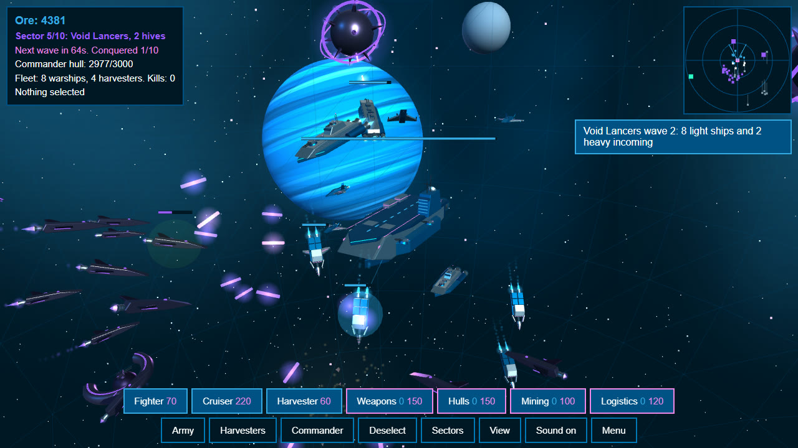
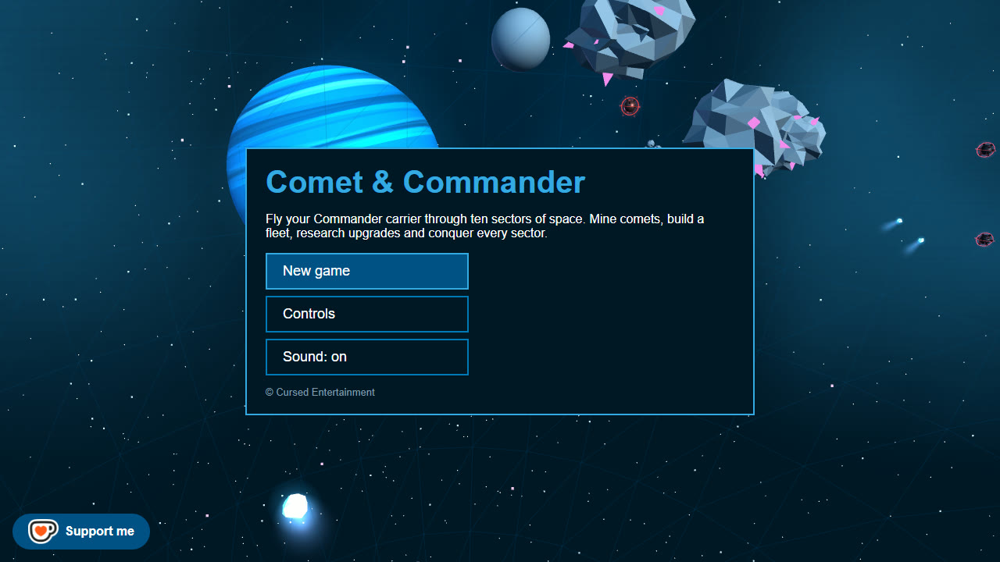
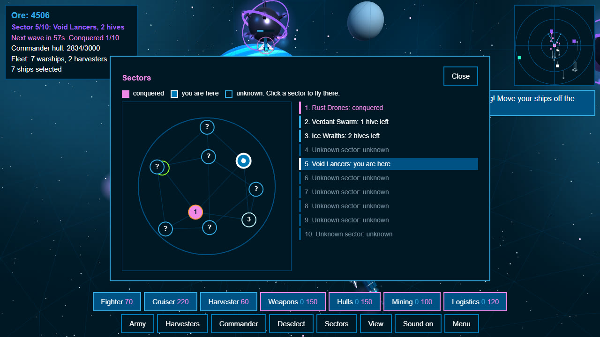
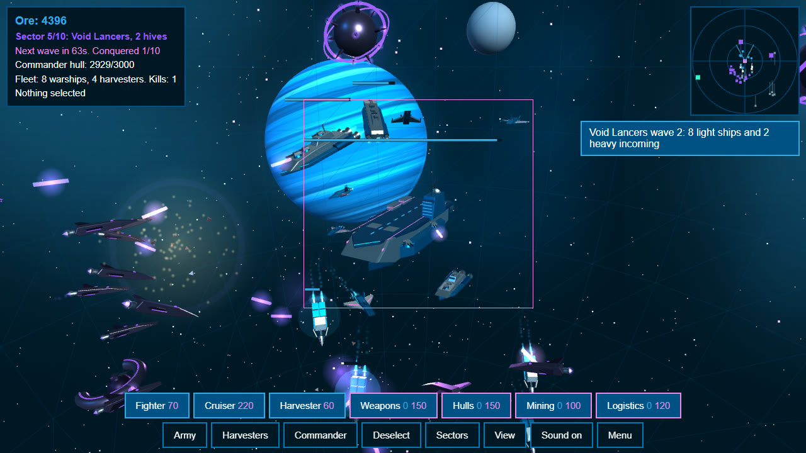
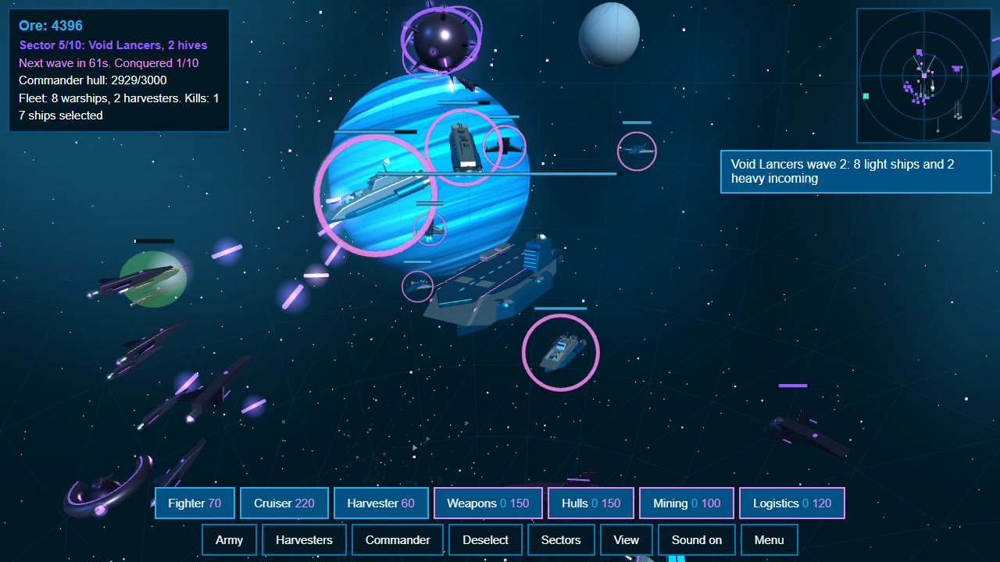
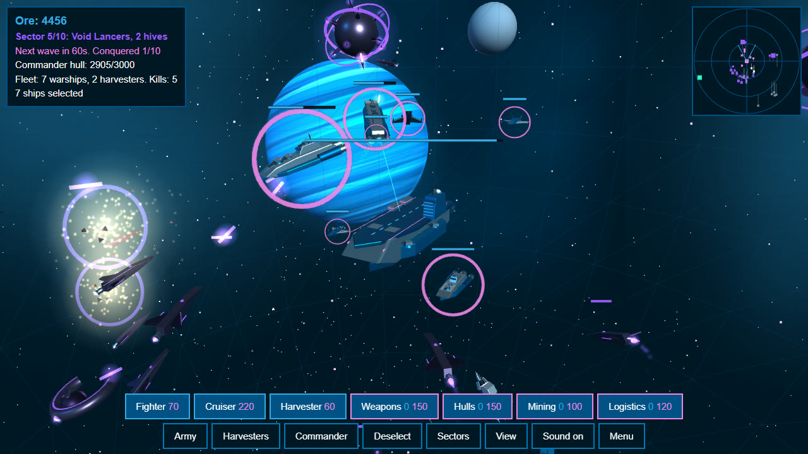
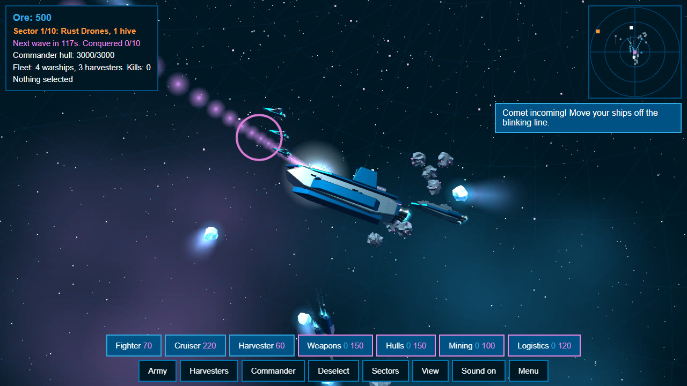
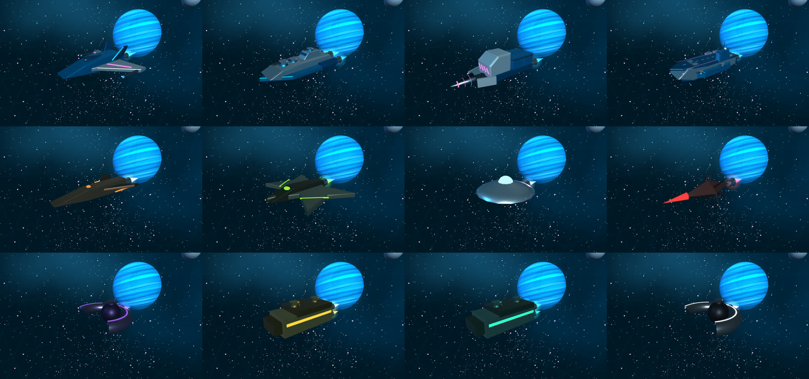

 

  

   

  
  
  

    
  
  
  
  

 

# Comets and the Commander

A 3D space RTS that runs in the browser. You fly the Commander, a carrier, through a sphere of space made of ten sectors, each held by a different enemy faction. The battle happens all around you: mine comets and asteroids, build a fleet, research upgrades and conquer every sector.

**Play it:** [cursedprograms.github.io/comet-and-commander](https://cursedprograms.github.io/comet-and-commander/)

## Gameplay

- **Ten sectors, ten factions.** Each sector has its own enemy with its own colours, ship designs and tactics: Rust Drones swarm, Ice Wraiths hunt your harvesters, Crimson Reavers ram, Void Lancers snipe from range, Gold Sentinels repair themselves, Teal Menders heal each other, Amber Splitters burst into smaller ships, the Obsidian Guard is shielded, and the Pale Choir in the last sector does all of it. Destroy every hive in a sector to conquer it; conquer all ten to win.
- **Fly anywhere.** Select the Commander and right-click to move it, or pick a sector on the sector map. The battle sphere and your idle warships travel with you.
- **Your sphere.** Your ships only fight inside the battle sphere round the Commander: an enemy or hive outside it is out of reach, and ships sent past its edge stop there. To take on a hive, fly the Commander to it.
- **Waves.** The first wave comes after 75 seconds, then every 48 seconds or less (sooner in later sectors and as the waves go on), each bigger than the last, with heavies from early on. Every fifth wave is a big one. Every wave also sends raiders in from the edge of your sphere, from any side, so sitting still doesn't keep you safe. The other sectors' factions raid you too, wherever you are: their ships arrive at the edge of your sphere from the side their sector lies on, nearer sectors more often, bigger as the game goes on.
- **Economy.** Four resources, each with its own harvester: meteorites give **steel**, comets give **water**, the rarer green meteorites give **fuel**, and the really rare silver crystals far out give **aluminium**, which only a **Smelter** can process. The Tech Centre, the Dreadnought and the Usurper need aluminium. Ships cost steel and fuel, buildings steel and water; fuel also powers black holes and the Pathfinder outside your spheres. Harvesters unload at the Commander or a refinery. Up to 20 harvesters and 250 warships.
- **Three queues.** Ships, base buildings and research build at the same time, 20 each. Click an item in a queue to cancel it (or right-click its button): everything it cost comes back.
- **The Pathfinder.** A scout you can fly yourself, third person (T): W thrust, S brake, A/D turn, arrows pitch, Shift boost. It takes RTS orders anywhere, inside your sphere or out, burning fuel out there. It plants **black holes** (Space while flying, or the Black hole button, 250 fuel): for 20 seconds they pull in and swallow enemy ships.
- **The panel.** Everything sits in one panel along the bottom, Age of Empires style: status, the Ships / Base / Research tabs and commands, the three queues, and the radar. The battlefield ends where the panel begins, and the panel slims down on short screens.
- **Splash.** The Cursed splash screen first, like the Arcade Phantasm games; any key or click goes on to the menu.
- **Buildings.** Solar plants, refineries (harvesters unload there for a quarter more ore), a Tech Centre, defence turrets, shipyards and repair docks. They float where they're built; solar plants power the rest, and you can see the sparks carry it: enemy ships caught in a spark take damage, so your power lines are a fence (and an Overlord's power lines hurt your ships). Short of power, everything works slower. Buy the Tractor and they travel with the Commander.
- **Research and the Commander.** The Tech Centre unlocks weapons, hulls, mining and logistics research, the Dreadnought (your very special ship: a lance whose hits splash) and the Usurper. The Commander has its own upgrades: armour, guns and the Tractor.
- **Spires and nests.** Every sector has two kinds of hive: spires, which you destroy, and nests, which can't be destroyed, only captured. Send a Usurper to a nest (right-click it) and it's yours: its garrison defects, it builds its faction's ships for you, and it becomes a sphere of your empire where your ships can fight. **Spheres** (J) jumps between them.
- **Garrisons, turrets and flagships.** Spires keep a garrison that grows even while you're away, static turrets round them, and every faction has a flagship with its own trick: the Scrap Mother launches drones, the Frost Matriarch slows your ships, the Bloodhammer rams, the Void Spear snipes from far away, the Fission Titan bursts into heavies, and more. Bombers go for your buildings.
- **Overlords.** Some sectors have an Overlord: an enemy commander who plays like you, with miners, refineries and solar plants. It builds a fleet (up to 250 ships; the other factions field 100), keeps a defence and attacks when you come near, or once the game has gone on a while. Knock out its power and it builds slower.
- **Research.** Weapons, hulls, mining and logistics (cheaper, faster ships), three levels each. Conquering a sector pays a bonus.
- **Comets.** Now and then a comet streaks in from any direction. A blinking line, an alarm and a voice warning give you a few seconds to get out of its way; it tears through anything it hits.
- **Menu, music and saves.** A main menu with the main theme, two in-game tracks that crossfade between calm and battle, sound effects, Piper voice lines, and an automatic save you can continue later.

| | |
| --- | --- |
|  |  |
|  |  |
|  |  |

## Controls

| | Mouse | Touch |
| --- | --- | --- |
| Select | Click a ship, drag a box, Shift adds, double-click picks every ship of that type | Tap a ship |
| Order | Right-click space to move, an enemy to attack, a comet to mine; with the Commander selected, right-click flies it | Tap where to go |
| View | Right-drag turns the view 360 degrees round you, wheel zooms | Drag, pinch |

Keys: F/C/H build, X army, Z harvesters, B Commander, N sector map, Ctrl+1-9 make a group and 1-9 pick it, WASD or arrows turn the view, Q/E zoom, P pause, M sound, Esc menu.

## Files

- `index.html` - the page
- `styles/style.css` - layout and colours
- `scripts/game.js` - game logic, sectors, input, HUD, radar, menu and saves
- `scripts/factions.js` - the ten enemy factions
- `scripts/models.js` - ship models, backdrop and effects (three.js r128)
- `scripts/audio.js` - music, synthesised sound effects and voice playback
- `audio/music/` - the soundtrack
- `audio/voice/` - voice lines, generated with [Piper](https://github.com/rhasspy/piper) TTS (Amy and Ryan voices)
- `images/` - screenshots

 

© Cursed Entertainment

 

